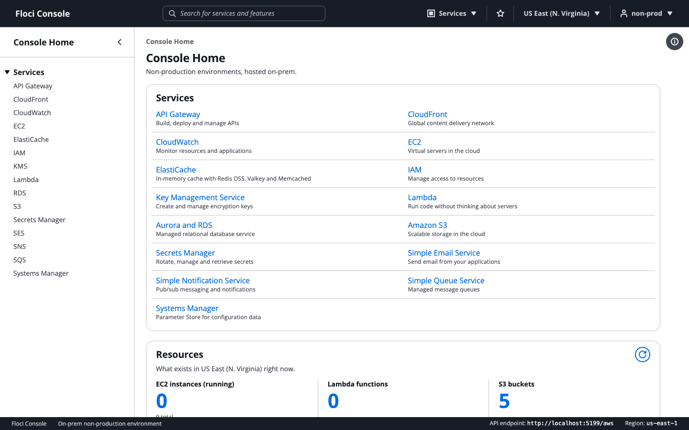
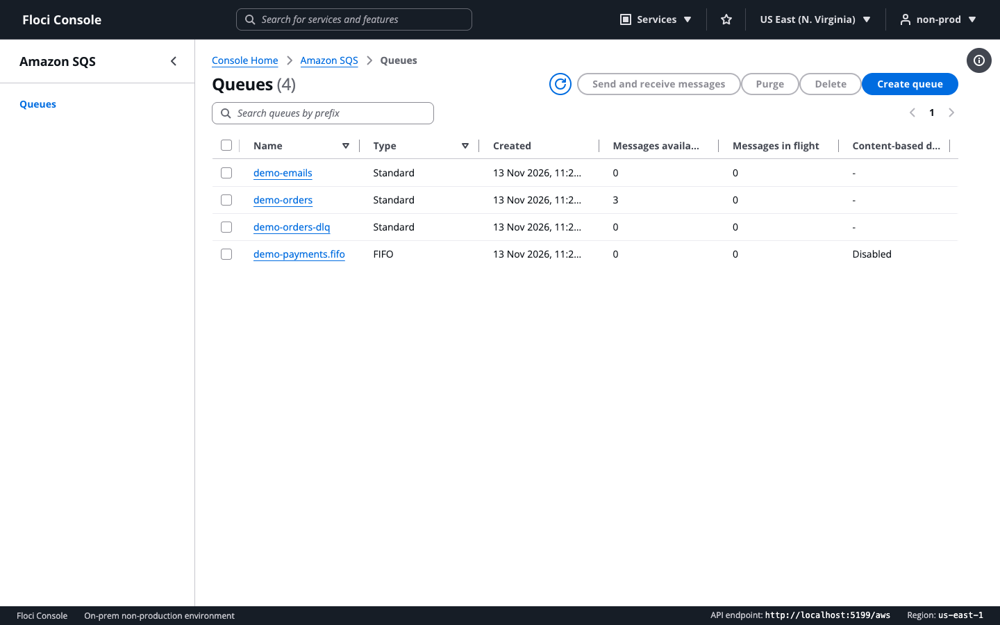
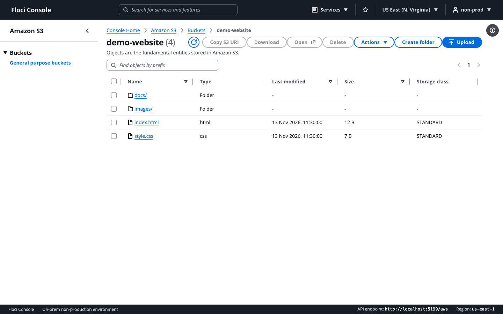
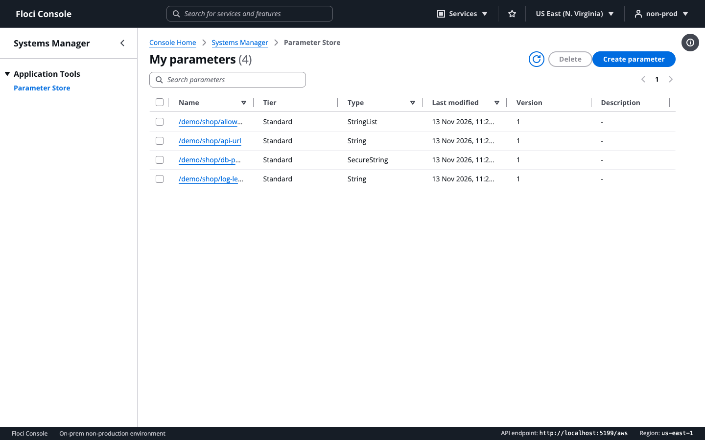
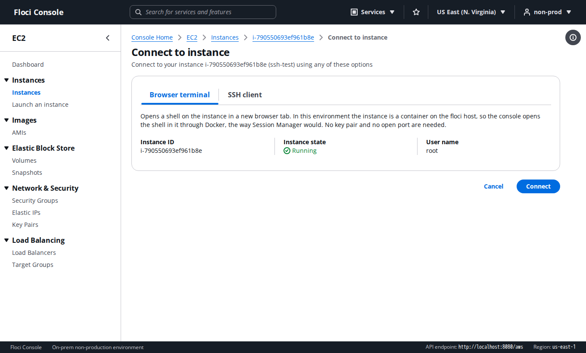
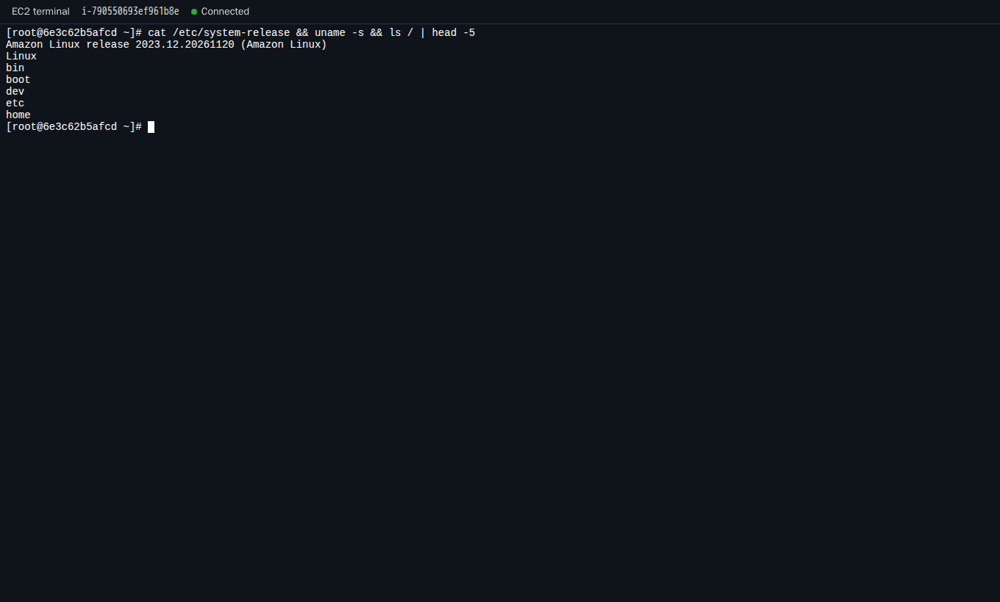

# Floci Console

A web console for [floci](https://floci.io), the local AWS emulator. It looks and works like the AWS console, so a team that knows AWS can use an on-prem non-prod environment without learning a new tool.

It is built with [Cloudscape](https://cloudscape.design), the open source design system that the AWS console itself uses.

> **The console has no login.** Anyone who can open it can change everything in floci. Run it only on a private network.

This is a community project. It is not part of floci and it is not affiliated with Amazon Web Services.

## Run it with npx

You need Node 20 or newer and a running floci. Nothing to install or build.

```sh
npx floci-aws-ui serve                                   # floci on http://localhost:4566
npx floci-aws-ui serve --floci http://your-floci-host:4566 --port 9000
```

Then open http://localhost:8080.

The command checks that floci answers. If it does not, it prints how to start floci and keeps running.

| Option | Default | Meaning |
|--------|---------|---------|
| `--floci`, `-f` | `http://localhost:4566` | Where floci listens. |
| `--port`, `-p` | `8080` | Port for the console. |
| `--host`, `-H` | `127.0.0.1` | Address to listen on. Use `0.0.0.0` to let other machines in. |
| `--accounts`, `-a` | | Accounts for the account menu, like `111111111111=storefront,222222222222=payments-api`. See [Accounts and organizations](#accounts-and-organizations). |
| `--terminal`, `-t` | off | Turn on the [EC2 browser terminal](#connect-to-an-ec2-instance). |

## See it in 21 seconds


The same clip with sound: [docs/video/floci-console.mp4](docs/video/floci-console.mp4). GitHub cannot play it in the page, so download it.

## Screenshots

**Console Home**



**SQS queues**



**S3 bucket**



**Parameter Store**



## What it covers

| Service | What you can do |
|---------|-----------------|
| **Console Home** | See resource counts, service health and the CLI profile for this environment. |
| **Lambda** | Dashboard. List, create and delete functions. Edit code in the browser and deploy. Run test events. Read logs. Change memory, timeout, handler and environment variables. Manage layers and event source mappings. |
| **S3** | Create, empty and delete buckets. Browse folders. Upload, download, open, preview and delete objects. |
| **CloudWatch** | Overview. Browse log groups and streams. Read log events with a time filter and live tail. Create and delete alarms. Graph metrics. |
| **EC2** | Dashboard. Launch, start, stop, reboot and terminate instances. Connect to an instance in a browser terminal or with SSH. Manage security groups, key pairs, volumes, snapshots and Elastic IPs. List AMIs. |
| **API Gateway** | REST APIs: resources, methods (Lambda, HTTP or mock), deploy to a stage. HTTP APIs: routes, integrations, stages. Send a test request to a stage from the page. |
| **CloudFront** | List, create, enable, disable and delete distributions. See origins and behaviors. Create invalidations. |
| **RDS** | Create, stop, start, reboot and delete databases. Shows the connect command. Snapshots and subnet groups. |
| **Secrets Manager** | Store, read, edit and delete secrets, as key/value pairs or plain text. |
| **IAM** | Users, user groups, roles and policies. Attach and detach policies. Create access keys. Edit trust policies. |
| **Parameter Store** | Create, edit and delete parameters. Version history. Show and hide SecureString values. |
| **SQS** | Create, purge and delete queues, standard and FIFO. Send a message. Poll for messages and read them. |
| **SNS** | Topics and subscriptions. Subscribe a queue, a function, a URL or an email address. Publish a message. |
| **SES** | Verify email addresses and domains. Send a test email. A mailbox page shows every email the environment captured. |
| **ElastiCache** | Create and delete Valkey, Redis OSS and Memcached caches. Shows the connect command. Replication groups. |
| **Load balancers** | Under EC2. Load balancers, listeners, target groups and registered targets. |
| **KMS** | Customer managed and AWS managed keys. Create, enable, disable and schedule deletion. Aliases, key policy, encrypt and decrypt. |
| **DynamoDB** | Create and delete tables with indexes. Change capacity, TTL and streams. Scan, query, create, edit and delete items as JSON. |
| **Cognito** | Create user pools, users, groups and app clients. Manage a user's attributes, password and groups. Test a sign-in and read the token claims. Create identity pools. |
| **Route 53** | Create public and private hosted zones. Manage DNS records and aliases. Associate VPCs. Create health checks. |
| **Certificate Manager** | Request or import certificates. See validation records and details. Manage tags. Copy the PEM. |
| **ECS** | Create clusters. Register task definitions with a form or JSON. Run tasks and services as real containers. Read their logs. |
| **ECR** | Create repositories. Browse and delete images. Edit lifecycle and repository policies. Get the push commands. |
| **EventBridge** | Create event buses, rules with targets, and schedules. Send test events and test event patterns. |
| **Step Functions** | Create and edit state machines. Start and stop executions. Read each execution's input, output and event history. |
| **VPC** | Create and delete VPCs, subnets, route tables with routes, internet gateways and NAT gateways. Manage VPC tags and DNS settings. |
| **CloudFormation** | Create, update and delete stacks from a YAML or JSON template. Follow their events, resources, outputs and parameters. |
| **Kinesis** | Create data streams. Read and put records. Change shards, retention and capacity mode. Manage enhanced fan-out consumers. |
| **OpenSearch** | Create and delete domains. See how to connect. Edit cluster settings, access policy and tags. |
| **AppSync** | Create GraphQL APIs. Edit the schema. Add data sources and resolvers. Manage API keys. Run queries. |

The top bar has a search box for services and pages. Every page has a help panel with the CLI profile.

## Accounts and organizations

Work with more than one AWS account, the way teams do in AWS. Give each project its own account and keep its resources apart.

- **Switch accounts from the top bar.** The account menu lists your accounts by name. Pick one, and every page shows that account's resources.
- **Your accounts are found for you.** The menu lists floci's default account, the accounts you name when you start the console, and every account in your organizations.
- **Open any account.** Type an account ID to open an account that is not in the list.
- **Manage your organization.** Choose **Organization** in the account menu, as in AWS. See your accounts grouped into organizational units, add accounts, move them between units, and attach service control policies.
- **Use the same account from the CLI.** Console Home shows the CLI profile for the account you are in.

To name your accounts in the menu, start the console with `--accounts 111111111111=storefront,222222222222=payments-api`, or set `FLOCI_ACCOUNTS`. See [Settings](#settings).

## Use the AWS CLI through the console

The console's own `/aws` path is a full AWS endpoint. A team needs only one URL:

```ini
# ~/.aws/config
[profile floci]
region = us-east-1
endpoint_url = http://your-console-host:8080/aws
aws_access_key_id = test
aws_secret_access_key = test
```

```sh
aws --profile floci s3 ls
```

## Works with floci's signature checks

The web console works when floci checks request signatures the way AWS does (`FLOCI_AUTH_VALIDATE_SIGNATURES=true`).

Floci's checks bring two limits:

- **Accounts.** Besides floci's default account, an account opens only if it has the `OrganizationAccountAccessRole` role. Accounts created from your organization have it.
- **Host names.** To open the web console under a name other than `localhost` or `127.0.0.1`, add the name to `FLOCI_CONSOLE_HOSTS`.

See [Signature validation](docs/SIGNATURE_VALIDATION.md) for details.

## Connect to an EC2 instance

Select a running instance and choose **Connect**, as in the AWS console. The page has two tabs.

- **Browser terminal** opens a shell on the instance in a new browser tab. No key pair or open port is needed.
- **SSH client** shows the `ssh` command for an instance that was launched with a key pair. floci installs the key for `root` and publishes port 22 on a host port from 2200 up.





floci has no EC2 Instance Connect or Session Manager for EC2, so the browser terminal does it another way. Each instance is a container on the floci host, and the console server opens a shell in it with the Docker Engine API (`docker exec` with a TTY), then streams it to the page over a WebSocket. It finds the container by the labels floci puts on it.

The browser terminal is **off by default**. To turn it on, start the console with `EC2_TERMINAL=1` and give it the Docker daemon that floci uses:

```yaml
  console:
    image: ghcr.io/varun1505/floci-aws-ui:latest
    user: root                       # the image runs as "node", which cannot open the socket
    environment:
      FLOCI_ENDPOINT: http://floci:4566
      EC2_TERMINAL: "1"
    volumes:
      - /var/run/docker.sock:/var/run/docker.sock
```

With npx: `npx floci-aws-ui serve --terminal`. From source: set `EC2_TERMINAL=1` in `.env.local`.

> **Access to the Docker daemon is root on the Docker host.** With the terminal on, anyone who can open the console can run commands in your instances, and a determined user can reach the host. The server only opens shells in containers that floci labels as EC2 instances, and it refuses WebSocket connections from other web sites, but the console still has no login. Turn the terminal on only on a private network you trust.

## Run it from source

You need Node 22 or newer, pnpm, and a running floci.

```sh
pnpm install
cp .env.example .env.local   # then set FLOCI_ENDPOINT to your floci address
pnpm dev                     # http://localhost:5173, with live reload
```

## Run it for a team

```sh
pnpm build
FLOCI_ENDPOINT=http://your-floci-host:4566 PORT=8080 pnpm start
```

## Run it with Docker

**You already have floci.** Pull the image and point it at floci:

```sh
docker run -d -p 127.0.0.1:8080:8080 \
  -e FLOCI_ENDPOINT=http://your-floci-host:4566 \
  ghcr.io/varun1505/floci-aws-ui:latest
```

Then open http://localhost:8080.

**You have nothing yet.** `compose.yaml` starts floci and the console together:

```sh
docker compose up -d
```

Both commands listen on your own machine only. Use `-p 8080:8080` to let other machines in. Read the warning about login above first.

**Let floci start it.** floci can run this console as its own sidecar. Set one variable on floci:

```yaml
services:
  floci:
    image: floci/floci:latest
    ports:
      - "4566:4566"
    volumes:
      - /var/run/docker.sock:/var/run/docker.sock
    environment:
      FLOCI_SERVICES_UI_IMAGE: ghcr.io/varun1505/floci-aws-ui:latest
```

Then open http://localhost:4566/_floci/ui. floci starts the console and sends you to it on port 4500.

This works because the image follows the [Floci Console Contract v1](https://floci.io/floci/ui/console-contract/). It listens on `PORT`, reads `AWS_ENDPOINT_URL`, and answers `GET /api/health` with `ok` only when it can reach floci.

| Image tag | What it is |
|-----------|------------|
| `latest` | The newest commit on `main`. |
| `1.2.3`, `1.2` | A release. |

The image runs on `amd64` and `arm64`. To build it yourself: `docker build -t floci-console .`

## Tests

```sh
pnpm test        # run all tests once
pnpm typecheck   # check the types
```

The tests need no floci and no network. They cover the helper functions, the shared components, the navigation, one full page (SQS queues) with a fake SDK client, the production server with a fake floci, and the `floci-aws-ui` command.

## How it works

```
browser  ->  this server (/aws/*)  ->  floci (:4566)
```

- The pages use the normal AWS SDK for JavaScript. The SDK points at `/aws` on the same server.
- The server forwards `/aws/*` to floci. This is needed because floci does not answer browser CORS preflight requests.
- The web console signs with `test` / `test`, or with the 12-digit ID of the account you chose as the access key. Nothing reaches real AWS. When floci checks signatures, the console server signs each request again with credentials floci accepts. See [Signature validation](docs/SIGNATURE_VALIDATION.md#how-it-works).

## Settings

| Variable | Default | Meaning |
|----------|---------|---------|
| `AWS_ENDPOINT_URL` | `http://localhost:4566` | Where floci listens. `http://` or `https://`. |
| `FLOCI_ENDPOINT` | | The same. Read when `AWS_ENDPOINT_URL` is not set. |
| `FLOCI_TLS_SKIP_VERIFY` | not set | Set to `1` to accept floci's self-signed certificate. |
| `PORT` | `8080` | Port for the production server. |
| `HOST` | all addresses | Address the production server listens on. `npx floci-aws-ui serve` uses `127.0.0.1` unless you set it. |
| `FLOCI_ACCOUNTS` | not set | Accounts for the account menu, like `111111111111=storefront,222222222222=payments-api`. See [Accounts and organizations](#accounts-and-organizations). |
| `FLOCI_DEFAULT_ACCOUNT_ID` | `000000000000` | floci's default account, when floci's manifest does not say. Set it to the same value you give floci. |
| `AWS_ACCESS_KEY_ID`, `AWS_SECRET_ACCESS_KEY`, `AWS_SESSION_TOKEN` | `test` / `test`, no token | The console server's own credentials, used when floci checks signatures. See [Signature validation](docs/SIGNATURE_VALIDATION.md#settings). |
| `FLOCI_CONSOLE_ROLE_NAME` | `OrganizationAccountAccessRole` | The role the console server assumes in accounts other than floci's default one, when floci checks signatures. The console server does not start when this is not a valid role name. |
| `FLOCI_CONSOLE_HOSTS` | not set | More host names the console server signs for when floci checks signatures, like `console.lan,10.0.0.5`. `localhost`, `127.0.0.1`, `::1` and `HOST` are always allowed. It does not change who can connect. See [Host names](docs/SIGNATURE_VALIDATION.md#host-names). |
| `EC2_TERMINAL` | not set | Set to `1` to turn on the EC2 browser terminal. |
| `DOCKER_HOST` | `unix:///var/run/docker.sock` | The Docker daemon the browser terminal uses. `unix://` or plain `tcp://`. Must be the one floci starts instances on. |

## Known limits

- **No login.** Anyone who can open the console can change everything in floci. Keep it on a private network.
- **When floci checks signatures, switching accounts needs a role.** The web console reaches accounts other than floci's default one through `OrganizationAccountAccessRole`. See [Works with floci's signature checks](#works-with-flocis-signature-checks).
- **floci keeps state in memory** unless it was started with `--persist`. A floci restart wipes all resources.
- floci does not write the `START`, `END` and `REPORT` lines to Lambda logs. You only see what your code prints.
- floci does not publish Lambda or EC2 metrics on its own. The Metrics page shows only metrics your apps send.
- EC2 instances run as containers on the floci host. There is no serial console output. The browser terminal logs in as `root`, not `ec2-user`.
- IAM stores users, roles and policies, but floci does not enforce them. A call that a policy denies still works here.
- SES sends no real email. Read sent messages on the Mailbox page.
- Load balancers are created and listed. Sending traffic through one is not tested.
- An RDS endpoint address is internal to Docker. Connect to the floci host on the port the page shows.
- API Gateway stages answer at `<console>/aws/_aws/execute-api/<api-id>/<stage>/<path>`, not at an `amazonaws.com` URL.
- A CloudFront distribution gets a `cloudfront.net` name, but that name does not resolve on your network. Serving content through a distribution is not tested.

## Add a service

1. Add a client in `src/clients/`.
2. Add pages in `src/pages/<service>/`. `ResourceTable` gives you the standard list page.
3. Add the routes in `src/App.tsx` and the side navigation in `src/components/nav.ts`.

See [docs/STATUS.md](docs/STATUS.md) for what was tested, what floci does differently, and how the code is laid out.

## License

[Apache-2.0](LICENSE)
